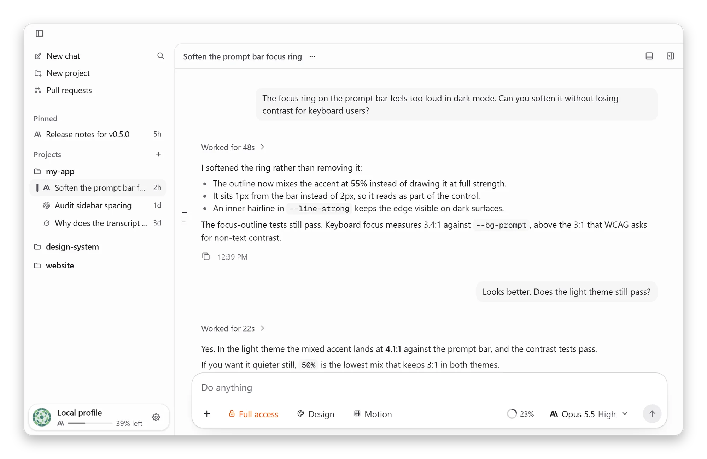
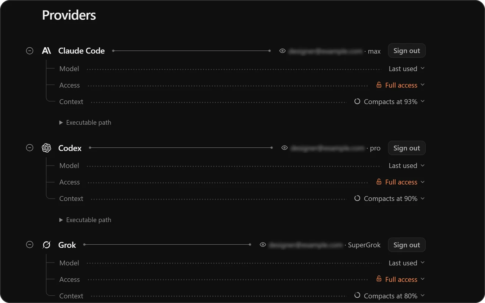
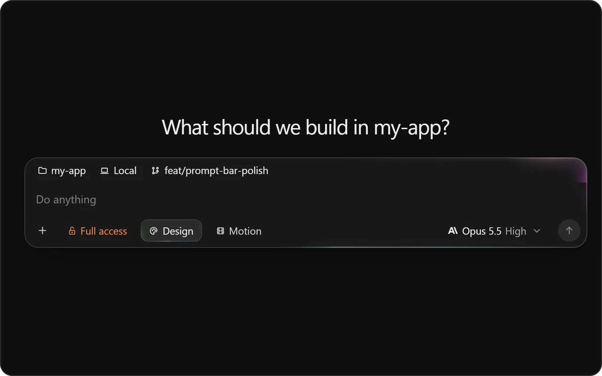
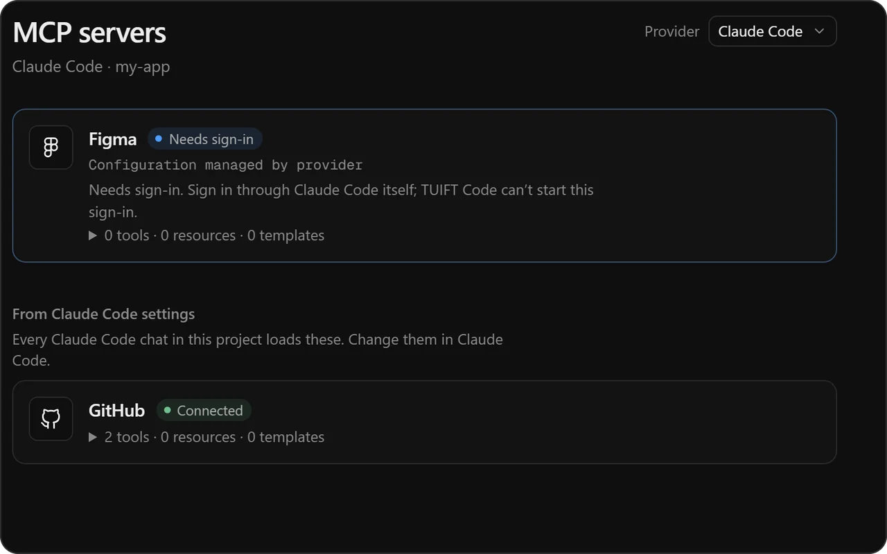
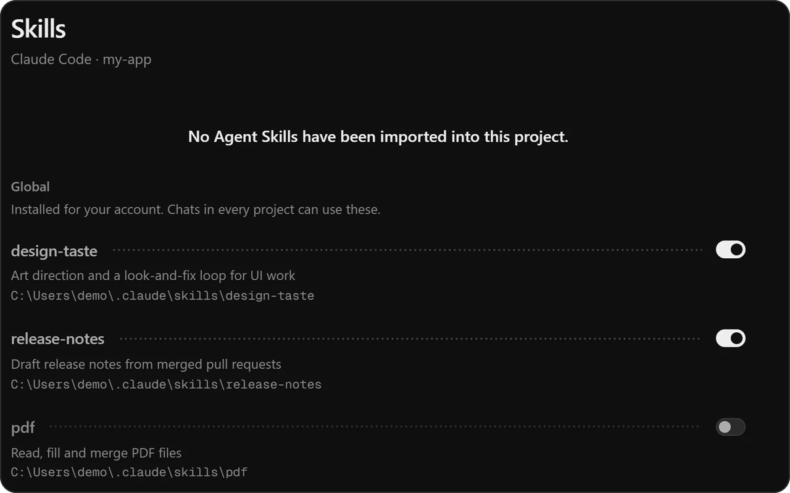
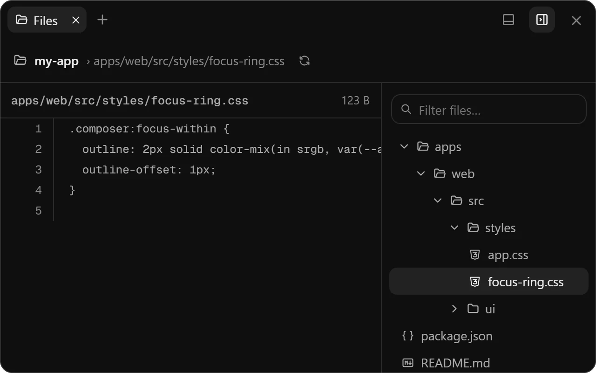
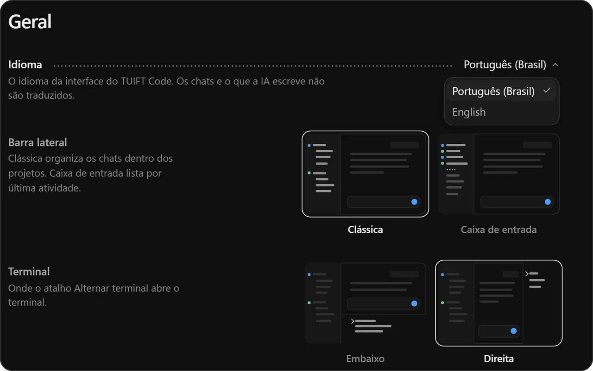
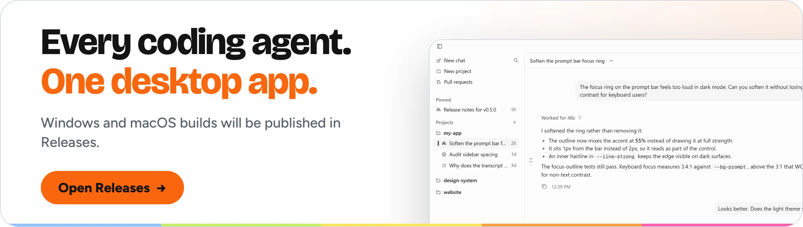

<p align="center">
  <picture>
    <source media="(prefers-color-scheme: dark)" srcset="branding/readme/wordmark-dark.png" />
    
  </picture>
</p>

<h3 align="center">All your coding agents in one local desktop app.</h3>

<p align="center">
  <a href="LICENSE"></a>
  <a href="#get-it"></a>
  <a href="#get-it"></a>
  <a href="#credits-and-license"></a>
</p>

<p align="center">
  <a href="#features">Features</a> ·
  <a href="#get-it">Get it</a> ·
  <a href="#run-from-source">Run from source</a> ·
  <a href="#credits-and-license">Credits</a> ·
  <a href="../../issues">Issues</a>
</p>

<p align="center">
  <picture>
    <source media="(prefers-color-scheme: dark)" srcset="branding/readme/produto-dark.webp" />
    
  </picture>
</p>

## What it is

One desktop app for your coding agents. Codex, Claude Code and Grok run side by side, each on your own provider subscription, and you pick the model that fits each task. Orchestration, project state, terminal, diffs, checkpoints and history stay on your machine: it is local-first.

## Features

<table>
  <tr>
    <td width="50%" valign="top">
      <br />
      <b>Every agent, one window</b><br />
      <sub>Codex, Claude Code and Grok in one sidebar, each on your own subscription. Pick the model and the reasoning effort per chat.</sub>
    </td>
    <td width="50%" valign="top">
      <br />
      <b>Design Mode</b><br />
      <sub>Switch Design on in the prompt bar to build and review web interfaces with the agent you picked.</sub>
    </td>
  </tr>
  <tr>
    <td width="50%" valign="top">
      <br />
      <b>MCP servers as cards</b><br />
      <sub>One card per server, with its status at a glance. Add, edit, sign in or turn servers off per provider and project.</sub>
    </td>
    <td width="50%" valign="top">
      <br />
      <b>Skills in one list</b><br />
      <sub>Global, project and built-in skills side by side, each with its own switch.</sub>
    </td>
  </tr>
  <tr>
    <td width="50%" valign="top">
      <br />
      <b>Files beside the chat</b><br />
      <sub>Files, terminal, browser and diff review open in a side panel next to the conversation. You do not have to leave the app.</sub>
    </td>
    <td width="50%" valign="top">
      <br />
      <b>Português or English</b><br />
      <sub>Pick the interface language in Settings. Translation starts with Settings and grows screen by screen; chats and what the AI writes are never translated.</sub>
    </td>
  </tr>
</table>

## Get it

<p align="center">
  <a href="../../releases">
    <picture>
      <source media="(prefers-color-scheme: dark)" srcset="branding/readme/banner-dark.webp" />
      
    </picture>
  </a>
</p>

**Early beta.** Builds will be published in [Releases](../../releases); there is none yet. Expect bugs and rough edges, and report them in [Issues](../../issues).

- Windows 10/11 x64 or macOS on Apple Silicon
- at least one supported provider CLI installed and signed in
- Git for project checkpoints and worktree features

## Run from source

Install Node 24 LTS and pnpm, then:

```text
pnpm install
pnpm dev
```

Provider processes run on your machine, and credentials stay with the provider or the operating-system credential store. See [SECURITY.md](./SECURITY.md) and [rules/security.md](./rules/security.md).

## Credits and license

TUIFT Code is based on [TasteCode](https://github.com/Leonxlnx/tastecode) by Leonxlnx and Blueemi, licensed under the Apache License 2.0, with our own name and icon. Interface, features and behavior follow TasteCode; changes are listed in [branding/README.md](./branding/README.md). "TasteCode" and its logo belong to their authors; TUIFT Code is not affiliated with or endorsed by them.

Licensed under the [Apache License 2.0](./LICENSE), like TasteCode. See [NOTICE](./NOTICE), [CREDITS.md](./CREDITS.md) and [THIRD_PARTY_NOTICES.md](./THIRD_PARTY_NOTICES.md).
